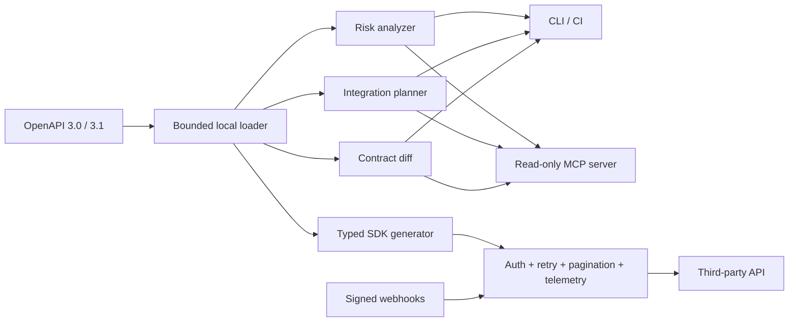

# Integration Doctor

I built Integration Doctor to make the boring and failure-prone parts of third-party API work easier to review. Give it an OpenAPI contract and it points out integration risks, suggests a practical implementation shape, compares contract versions, and can generate a typed client.

The CLI, library, and MCP server all use the same analysis code. That was important to me: an agent should not give different advice from the checks running in CI.

## The five-minute demo

Requires Node.js 22+.

```sh
npm install
npm run check
node dist/cli.js inspect examples/contacts.yaml
node dist/cli.js diff examples/contacts.yaml examples/contacts-v2-breaking.yaml --strict
node dist/cli.js generate examples/contacts.yaml generated/contacts-sdk
```

The demo never contacts the example API. Existing output directories are protected from overwrite.

## What it proves

- **Contract intelligence:** deterministic checks for authentication, operation identity, errors, rate limits, pagination, path parameters, idempotency, and unsafe external references.
- **Integration topology:** explicit *candidate* syncs, actions, auth schemes, and webhook surfaces, with rationales so a developer can reject a bad heuristic.
- **Compatibility engineering:** old/new contract diff with breaking-change classification and CI-friendly exit codes.
- **Executable SDK generation:** OpenAPI types plus an `openapi-fetch` client—not types alone.
- **Production runtime primitives:** pluggable auth, timeouts, cancellation, structured errors, secret redaction, telemetry events, bounded exponential retries, `Retry-After`, safe-write idempotency, and loop-safe cursor pagination.
- **Webhook security:** timestamped HMAC-SHA256 signing, constant-time verification, and replay windows.
- **Agent-native DX:** three read-only MCP tools and a reusable agent skill backed by the same core as the CLI.

## Architecture



The analysis path is offline and deterministic. Network access only exists in the exported `IntegrationClient`, where the application explicitly supplies a base URL and invokes a request.

## Runtime example

```ts
import { IntegrationClient, paginate } from 'integration-doctor/runtime';

const api = new IntegrationClient({
  baseUrl: 'https://api.example.com',
  auth: () => ({ authorization: `Bearer ${process.env.API_TOKEN}` }),
  onEvent: event => telemetry.emit(event),
});

for await (const contact of paginate(async cursor =>
  api.request({ path: '/contacts', query: { cursor } })
)) {
  await saveContact(contact);
}

// POST is never retried unless the caller supplies an idempotency key.
await api.request({
  method: 'POST', path: '/contacts', body: { name: 'Ada' },
  idempotencyKey: crypto.randomUUID(),
});
```

## MCP server

```json
{"mcpServers":{"integration-doctor":{"command":"node","args":["/absolute/path/IntegrationDoctor/dist/cli.js","mcp","/absolute/path/workspace"]}}}
```

- `analyze_openapi({ file })` — deterministic risks and review points.
- `plan_integration({ file })` — auth, sync, action, and webhook candidates.
- `diff_openapi({ before, after })` — likely breaking API changes.

All MCP paths are realpath-checked against the configured workspace, input is capped at 5 MB, external references are never fetched, and every tool is declared read-only.

## Engineering boundaries

This is not a complete OpenAPI validator, OAuth broker, durable job runner, or vulnerability scanner. Planning is heuristic and labeled as such. The diff currently analyzes operation/parameter/body/response surface changes; deep JSON Schema variance is a deliberate next milestone. Runtime validation, refresh-token concurrency, distributed rate limiting, durable retries, and tenant isolation belong in the hosting application or integration platform.

That boundary is intentional: good infrastructure says what it guarantees and where ownership changes.

## Development

```sh
npm run build
npm test
npm run check
```

Tests exercise the CLI core, actual MCP stdio transport, workspace traversal denial, generated SDK output, breaking diffs, retry safety, `Retry-After`, pagination loops, signature tampering, and replay attacks.

See [SECURITY.md](SECURITY.md) for the threat model and [docs/architecture.md](docs/architecture.md) for design decisions and the roadmap.

---

**Note for the Nango team:** this project previously only ran on my machine as part of my own development workflow. I pushed it to GitHub because the application form asks for a public example of developer tooling. The repository has no prior company adoption or production usage behind it; it is here so you can inspect the code and the engineering decisions directly.
